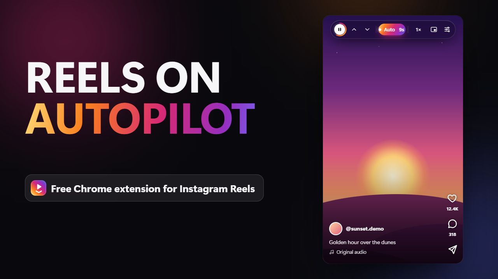

# ReelPilot – Auto Scroll for Instagram Reels

[](https://chromewebstore.google.com/detail/reelpilot-%E2%80%93-auto-scroll-f/bphneemeaeekncgbmhfjjhfbplhplced)

A Chrome extension that scrolls to the next Instagram reel automatically, puts playback controls on
top of the reels, and **keeps running when you switch to another tab**, including in
Picture-in-Picture.

**[Get it on the Chrome Web Store](https://chromewebstore.google.com/detail/reelpilot-%E2%80%93-auto-scroll-f/bphneemeaeekncgbmhfjjhfbplhplced)** ·
**[Watch the 46-second demo](https://www.youtube.com/watch?v=Ak9mns1-8Ho)**

[](https://www.youtube.com/watch?v=Ak9mns1-8Ho)

## Install

**From the Chrome Web Store:** open the
[ReelPilot store page](https://chromewebstore.google.com/detail/reelpilot-%E2%80%93-auto-scroll-f/bphneemeaeekncgbmhfjjhfbplhplced) and
click **Add to Chrome**.

**From this repository (developer mode):**

1. Get the code: **Code → Download ZIP** on GitHub and unzip it, or
   `git clone https://github.com/Mousta-Med/IG-Extension.git`.
2. Open `chrome://extensions` in Chrome (Edge: `edge://extensions`).
3. Turn on **Developer mode** (top-right switch).
4. Click **Load unpacked** and select the folder that contains `manifest.json`.
5. Pin ReelPilot from the puzzle-piece menu so its icon stays in the toolbar.
6. Open <https://www.instagram.com/reels/>. The panel appears at the top-right of the page.

If Instagram was already open, the extension connects to it automatically. If the panel doesn't
show up, refresh the Instagram tab once.

## Using it

| Control | What it does |
| --- | --- |
| **Auto-scroll** switch | Moves to the next reel automatically |
| **Advance → When it ends** | Moves on after the reel has played *N* times (the **Plays** setting, 1–10) |
| **Advance → Timer** | Moves on after a fixed number of seconds (3–120 s) |
| **↑ / ▶ / ↓** | Previous reel · play/pause · next reel. The ring shows the time until the next reel |
| **PiP** | Opens the reel in a floating Picture-in-Picture window that stays on top of other apps |
| **On reel / Panel** | Switches between the compact bar on top of the reel and the floating panel |
| **Progress bar** | Click or drag to seek |
| **Speed** | 0.5× – 2× (pitch is preserved) |
| **Volume** | Volume slider and mute button |
| **Options** | Background play, skip sponsored reels, smooth scrolling, auto Picture-in-Picture, fade the controls when idle |

- **Drag** the panel by its header to move it. It remembers where you put it.
- **–** shrinks it to a small floating button that shows the reel's progress. Click the button to open the panel again.
- **×** hides the panel. Turn it back on from the toolbar popup (**Show the panel on the page** or
  Options → *Show on-page controls*).

### Controls on the reel

Press **On reel** to swap the panel for a compact bar pinned to the top of the reel. The bar follows
each reel as it changes and fades out after a few seconds; move the mouse over the reel to bring it
back. It has play/pause (with a countdown ring), previous/next, the **Auto** switch with seconds
until the next reel, speed (click for faster, right-click for slower), PiP, and ⚙, which opens the
full panel for everything else. Press **Panel** there to go back to the floating panel.

### Picture-in-Picture

Press **PiP** to pop the reel out into a small always-on-top window. While auto-scroll is on, the
window **switches to each next reel by itself**, so you can keep watching while working in other
apps. Chrome's PiP window also shows ⏮ ⏭ buttons that skip reels.

Turn on **Options → Auto Picture-in-Picture** and the reel pops out automatically when you switch
tabs, where Chrome supports it.

Image reels and image ads can't go into Picture-in-Picture (it only plays video). The window keeps
showing the last video until the next video reel arrives.

### Image reels and ads

Some reels, including many ads, are still images. ReelPilot shows them for 5 seconds (or for your
**Timer** setting) and then moves on. With **Skip sponsored reels** on, ads labelled *Sponsored* or
*Ad* (in many languages) are skipped straight away.

### Control it from any tab

- **Toolbar popup**: click the ReelPilot icon while you're on any site. It works as a remote control
  for the Instagram tab (play/pause, next/previous, auto-scroll and all settings).
- **Badge**: while auto-scroll is on, the icon shows how many reels you've watched.
- **Keyboard shortcuts** (work in any Chrome tab):

  | Shortcut | Action |
  | --- | --- |
  | `Alt+Shift+S` | Toggle auto-scroll (opens Reels if needed) |
  | `Alt+Shift+K` | Play / pause |
  | `Alt+Shift+↓` | Next reel |
  | `Alt+Shift+↑` | Previous reel |

  Change them at `chrome://extensions/shortcuts`. Set a shortcut's scope to **Global** there and it
  works even when Chrome isn't the focused app.
- **Media keys**: the keyboard's ⏭ / ⏮ keys and Chrome's media controls skip reels too.

## How background playback works

Instagram pauses reels and stops loading new ones when its tab is hidden. ReelPilot counters this
on three levels:

1. **Page hooks** (`src/page/page-hooks.js`, runs inside the page). Instagram is told the tab is
   still visible and focused, so it doesn't pause. Chrome stops computing *what's on screen*
   (`IntersectionObserver`) in hidden tabs, and Instagram depends on it to start the next reel and
   load more. The hooks compute it themselves while the tab is hidden.
2. **Engine** (`src/content/engine.js`). It counts plays from the video's own events, which are not
   throttled in background tabs. It scrolls and plays the next reel itself, and a watchdog restarts
   playback if anything pauses it or it stalls.
3. **Service worker**. Chrome slows a hidden tab's timers to as little as once a minute. The
   extension's service worker isn't throttled, so it wakes the tab up instead. It also stops Chrome's
   Memory Saver from unloading a tab that is auto-scrolling.

You can turn background playback off in **Options → Keep playing in background**.

## Troubleshooting

- **No panel:** make sure the URL is `instagram.com/reels/…`. The panel only appears on Reels.
  Refresh the tab once after installing or updating the extension.
- **Sound is muted after switching tabs:** Chrome only allows sound after you've clicked the page
  once. Click anywhere on the reels page, then unmute.
- **"No more reels loaded yet":** Instagram hasn't loaded the next reel yet (slow connection, or the
  end of the feed). Auto-scroll tries again a few seconds later.
- **Shortcut doesn't work:** another extension or app may be using it. Pick a new one at
  `chrome://extensions/shortcuts`.
- **PiP from the toolbar popup doesn't open:** Chrome sometimes only allows Picture-in-Picture to
  start from a click on the page. Use the PiP button on the Instagram tab; the popup shows a
  **Go to tab** button for this.

## Publishing to the Chrome Web Store

Everything for the store is ready. Follow **[store/LISTING.md](store/LISTING.md)** step by step:

- `python tools/build_zip.py` builds the upload package, `dist/reelpilot-<version>.zip`.
- `store/assets/` holds the screenshots, promo tiles and store icon. To regenerate them after UI
  changes, run `cd tools/store && npm install && npm run render`.
- [PRIVACY.md](PRIVACY.md) is the privacy policy the store links to. `store/privacy-policy.html` is the
  same text as a standalone page, if you prefer to host it elsewhere.
- `store/video/` holds the 46-second promo video and its YouTube thumbnail. **[store/YOUTUBE.md](store/YOUTUBE.md)**
  has the title, description and settings for uploading it. To re-render, run
  `cd tools/store && npm install && node ../video/render.mjs`.

## Development

The extension itself needs no build step: edit `src/`, then press the reload icon on ReelPilot's card
in `chrome://extensions`. Open Instagram tabs pick up the new version automatically.

The helper tools have their own requirements:

| Tool | Needs |
| --- | --- |
| `tools/make_icons.py`, `tools/build_zip.py` | Python 3 + Pillow |
| `tools/store/render.mjs` (store graphics) | Node 18+, Chrome, then `npm install` in `tools/store` |
| `tools/video/render.mjs` (promo video) | The above, plus ffmpeg and numpy |

## Project layout

```
manifest.json                 Manifest V3
src/page/page-hooks.js        Runs inside the page: visibility, IntersectionObserver and rAF hooks
src/content/engine.js         Playback engine: finds the current reel (video or image), counts plays, advances, PiP
src/content/overlay.js        On-page controls: floating panel or bar on the reel (Shadow DOM)
src/content/main.js           Wiring: settings, page navigation, messages, lifecycle
src/shared/                   Shared by panel and popup: settings, icons, design tokens, controls
src/popup/                    Toolbar popup (remote control)
src/background/               Service worker: shortcuts, badge, background timers
tools/make_icons.py           Regenerates icons/ (python tools/make_icons.py)
tools/build_zip.py            Builds the Chrome Web Store package into dist/
tools/store/                  Renders the store screenshots/tiles from the real UI
tools/video/                  Renders the promo video (timeline, soundtrack synth, encoder)
store/                        Store listing text, privacy policy and graphics
```

## Privacy

ReelPilot stores your settings locally in Chrome. It sends no data anywhere and doesn't touch your
Instagram account. It only controls the videos already on the page. Full policy:
[PRIVACY.md](PRIVACY.md).

---

ReelPilot is an independent project and is not affiliated with, endorsed by or sponsored by Instagram
or Meta Platforms, Inc. Instagram is a trademark of Meta Platforms, Inc.
